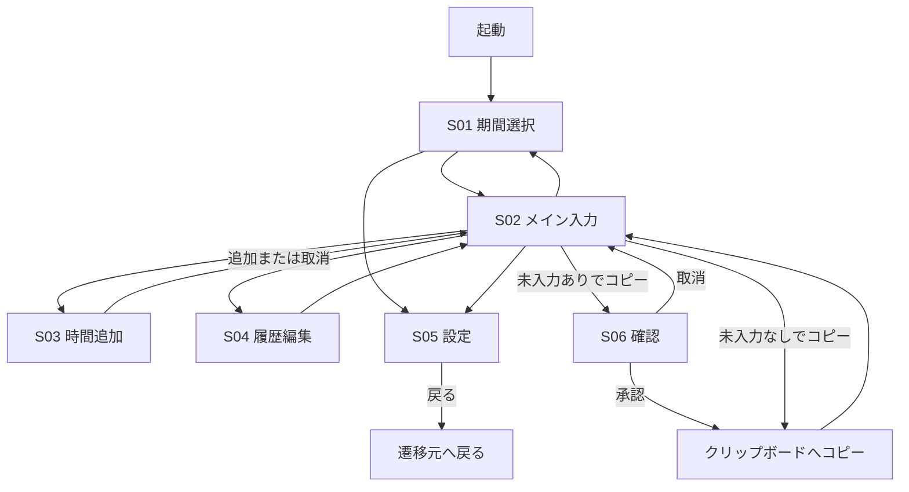
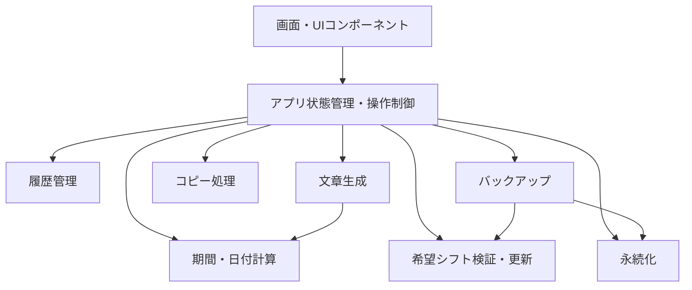

# シフトマネージャー — 開発引継ぎ・統合設計書

- 版：1.1（Phase 1 確認事項 Q01〜Q11 回答反映）
- 作成日：2026-11-25 ／ 更新日：2026-11-26
- 対象：iPhone向け個人用シフト希望作成PWA
- 状態：Phase 1 実装中。確認事項の回答は §11.1 を参照（本文の「案」より §11.1 を優先する）。

## 0. PC側の開発担当・AIへの引継ぎ

本書を仕様の基準とする。確定事項を勝手に変更せず、未確定事項や矛盾があれば実装前に利用者へ質問する。まず Phase 1 のみを実装し、カレンダー管理やLINE自動送信は後回しにする。実装後は本書の受入テストを実施し、結果と未解決事項を報告する。

## 1. プロジェクト方針

### 1.1 目的

アルバイト先へ半月ごとに提出する希望シフトを、手入力せずタップ中心で作成する。提出文章をコピーし、利用者本人がLINEに貼り付けて送信する。将来的に希望・確定シフトの管理や送信の省力化を行う。

### 1.2 開発ロードマップ

| Phase | 内容 | 対象範囲 |
|---|---|---|
| 1 | 希望シフト作成 | 今回。入力、履歴、一括設定、プレビュー、コピー、保存、バックアップ |
| 2 | シフト管理 | 過去・未来をカレンダー形式で閲覧、確定シフト管理。詳細は後日設計 |
| 3 | LINE共有 | 共有機能による貼り付けの省略。実装時に公式仕様を確認 |
| 4 | LINE送信自動化 | 実現可能性を調査してから設計。個人LINEからの無人送信は保証しない |

Phase 1では外部アカウント連携、サーバー、LINE送信処理、確定シフト管理を実装しない。希望シフトと確定シフトのデータは将来的にも分離する。

## 2. 要件定義書（利用者確定事項）

| ID | 項目 | 要件 |
|---|---|---|
| R01 | アプリ名 | シフトマネージャー |
| R02 | 対応端末 | iPhoneのみ（開発はPCで行う） |
| R03 | 提供方法 | 無料のWebアプリ/PWAをホーム画面に追加 |
| R04 | 外観 | iOS標準アプリ風。本体のライト・ダーク設定に連動 |
| R05 | 提出期間 | 毎月1日〜15日、16日〜末日 |
| R06 | 期間選択 | 今月・翌月のみ。起動時に毎回自分で選択 |
| R07 | 再編集 | 既存の期間を選ぶと保存内容を自動表示 |
| R08 | 時間範囲 | 10:00〜30:00（翌朝6時） |
| R09 | 時間間隔 | 30分単位。スクロール式ホイール |
| R10 | 入力種類 | 通常、開始のみ、終了のみ、OP、LA、○、× |
| R11 | 特殊指定 | OP・LA・指定なしはホイールとは別ボタン。出力は大文字OP/LA |
| R12 | 日付移動 | 通常入力確定後は自動で翌日へ。最終日は入力画面に留まる |
| R13 | 一括設定 | 複数日を選び同じ希望を適用。適用後は通常モードに戻り、最後の日付の翌日へ |
| R14 | 上書き | 入力済みの日付も確認なしで上書き可能 |
| R15 | 取消 | 入力済みの日付を未入力に戻せる |
| R16 | 時間履歴 | 最近使った順に最大10件。重複なし。個別削除可能 |
| R17 | 履歴超過 | 11件目は最も長く使われていない履歴を自動削除 |
| R18 | プレビュー | 入力画面の下部に常時表示。全日入力後も画面遷移しない |
| R19 | コピー | 指定書式の全日程を一括コピー |
| R20 | 未入力 | コピー時に確認を表示し、承認後に未入力を×として出力 |
| R21 | 挨拶文 | ON/OFF切替。先頭文・末尾文を別々に自由編集 |
| R22 | 自動保存 | 入力途中で終了しても保存。期間再選択時に復元 |
| R23 | コピー後 | 内容は初期化せず保存する |
| R24 | 過去データ | 過去の希望シフトをすべて保存。Phase 1では過去月の閲覧UIは対象外 |
| R25 | バックアップ | ファイルへの書き出し・復元 |
| R26 | 将来拡張 | 希望シフトと確定シフトを別管理できる設計にする |

### 2.1 出力書式

1日につき `M月D日（曜）　希望`（全角括弧、曜日1文字、全角スペース1つ）。月日ゼロ埋めなし。時刻は分が00なら省略、30なら `:30`。日付の昇順、改行区切り。24時超えを翌日表記に置換しない。

| 入力 | 出力例 |
|---|---|
| 通常 | 19-23 |
| 30分 | 18:30-23 |
| 深夜 | 19-30 |
| 開始のみ | 19- |
| 終了のみ | -23 |
| オープンから | OP-18 |
| ラストまで | 19-LA |
| オープンからラスト | OP-LA |
| 終日可能 | ○ |
| 勤務不可 | × |
| 未入力 | コピー時のみ × |

出力例（期間全体のうち先頭3行のみ抜粋）：

```text
12月1日（火）　19-23
12月2日（水）　18:30-LA
12月3日（木）　×
```

挨拶文ONの場合は先頭文、空行、日程、空行、末尾文の順とする案。空の挨拶文は省略する。改行の細部は未確定事項参照。

## 3. 画面設計書

### S01 期間選択画面

起動時に表示。今月・翌月それぞれの前半/後半の4候補。年をまたぐ場合も正しい年月を表示する。期間選択後、保存済み希望シフトを読み込んでS02へ移動する。設定画面への導線も置く案。

### S02 メイン入力画面

```text
┌────────────────────────┐
│ ＜期間選択   シフトマネージャー  ⚙ │
│ 2026年12月  前半 1〜15日        │
│  1火   2水   3木   4金   5土    │
│ 19-23  未入力  ×    未入力 ...  │
│  6日〜15日 …                  │
│ [複数選択]                    │
│ 12月2日（水）を編集中           │
│ 最近使った時間         [編集]  │
│ [19-23] [18:30-23] [19-LA]    │
│ [OP-18] [OP-LA]    [＋追加]    │
│ [○ 終日可能] [× 勤務不可]      │
│ [未入力に戻す]                 │
│ ────────────────────── │
│ 提出プレビュー    2/15日入力済み │
│ 12月1日（火）　19-23           │
│ 12月2日（水）　×               │
│ … 未入力は薄い色で区別          │
│ [挨拶文を付ける]               │
│ [シフトをコピー]               │
└────────────────────────┘
```

上記は配置案であり、実機に合わせて調整する。日付をタップして選択、履歴のタップで即適用。選択日、未入力、勤務不可、入力済みを視覚的に区別する。プレビューは別画面に移動せず、入力画面下部でリアルタイム更新する。画面をスクロールして確認できる構成を基本案とする（固定表示かどうかは確認事項）。

### S03 勤務時間追加シート

iOS風の下から出るシートを提案。開始と終了の独立したスクロールホイールを設ける。各ホイールは10:00, 10:30, …, 30:00の41候補。30:30は存在しない。開始側の別ボタンは「時刻 / OP / 指定なし」、終了側は「時刻 / LA / 指定なし」。特殊選択中は対応ホイールを無効化または非表示。下部に出力例、キャンセル、追加・適用ボタン。追加・適用で選択日へ反映し履歴を更新する。

### S04 履歴編集

最近使用した順に最大10件を表示し、個別削除できる。履歴の削除によって過去に設定した希望シフトは消さない。S02の編集モードまたは専用シートを使用する案。

### S05 設定画面

- 挨拶文ON/OFF、先頭文、末尾文の編集
- バックアップ書き出し、バックアップ復元
- アプリ情報・バージョン（提案）
- テーマはシステム連動。手動切替は現要件に含めない。

### S06 コピー確認ダイアログ

未入力がある場合のみ表示。「未入力の日付がN日あります。×としてコピーしますか？」 キャンセル/コピー。キャンセル時は内容・クリップボードを変更しない。承認しても元データは未入力のまま。コピー成功はAPIの成功後に通知する。

### 3.1 画面遷移図



## 4. 機能階層図

```text
シフトマネージャー
├─ 1. 期間管理
│  ├─ 1.1 今月・翌月の計算
│  ├─ 1.2 前半・後半の選択
│  └─ 1.3 日付・曜日・月末の計算
├─ 2. 希望シフト管理
│  ├─ 2.1 単一日選択
│  ├─ 2.2 複数日選択
│  ├─ 2.3 時刻・特殊指定入力
│  ├─ 2.4 適用・上書き・取消
│  ├─ 2.5 翌日移動
│  └─ 2.6 最近使用履歴管理
├─ 3. 提出管理
│  ├─ 3.1 書式変換
│  ├─ 3.2 プレビュー更新
│  ├─ 3.3 挨拶文合成
│  ├─ 3.4 未入力確認
│  └─ 3.5 クリップボード出力
└─ 4. データ・設定管理
   ├─ 4.1 自動保存・読み込み
   ├─ 4.2 過去データ保管
   ├─ 4.3 挨拶文設定
   ├─ 4.4 バックアップ書き出し
   └─ 4.5 バックアップ検証・復元
```

## 5. データ構造設計書（実装案）

日付は日本の暦日を示す `YYYY-MM-DD`、時刻は当日0時からの分数（10時=600、30時=1800）で保持する。日付をUTC変換して曜日がずれないようにする。深夜時刻は翌日に分割しない。データにはバージョンを付与する。

```ts
type Start = { kind: 'time'; minutes: number } | { kind: 'open' } | { kind: 'none' };
type End = { kind: 'time'; minutes: number } | { kind: 'last' } | { kind: 'none' };
type TimeShift = { kind: 'range'; start: Start; end: End };
type Shift = TimeShift | { kind: 'available' } | { kind: 'unavailable' };
type DateKey = string; // YYYY-MM-DD
interface ShiftRecord { shift: Shift; updatedAt: string }
interface HistoryEntry { id: string; shift: TimeShift; lastUsedAt: string }
interface PeriodMeta { lastEditedAt?: string; lastCopiedAt?: string }
interface Settings { greetingEnabled: boolean; greetingPrefix: string; greetingSuffix: string }
interface AppData {
  schemaVersion: 1;
  requests: Record<DateKey, ShiftRecord>;
  history: HistoryEntry[];
  periods: Record<string, PeriodMeta>; // YYYY-MM-first / YYYY-MM-second
  settings: Settings;
}
```

未入力は `requests` に日付キーが存在しない状態とする。勤務不可は `unavailable` として明示的に保存。履歴には勤務時間・特殊時間範囲を保持し、○/×は専用ボタンのため履歴外とする案。履歴の重複判定は正規化した開始/終了の組み合わせで行う。コピー日時は送信完了を意味しない。Phase 2の確定シフトは別のデータ領域を追加する。

## 6. モジュール構造図・インターフェース設計書



UIから直接保存先や書式生成を操作せず、状態管理・ドメイン処理経由とする。主要処理は独立して単体テスト可能にする。

| モジュール | 入力 | 出力・責務 |
|---|---|---|
| calendar | 年月・半月区分 | 日付一覧、曜日、次の日付、今月/翌月の候補 |
| shift | 開始・終了・種類 | 妥当性判定、日付への設定、未入力への復帰 |
| history | 適用した時間範囲・既存履歴 | 重複排除、最近順、10件制限、削除 |
| formatter | 期間、希望データ、挨拶文設定 | 提出文字列、プレビュー行、未入力件数 |
| storage | AppData | 保存・復元・エラー通知 |
| clipboard | 生成した文字列 | コピー成功/失敗 |
| backup | AppData / JSONファイル | 書き出し・構造検証・復元 |
| controller | UIイベント | 状態更新、画面遷移、保存指示 |

## 7. IPO・処理詳細設計書

| 処理 | Input | Process | Output |
|---|---|---|---|
| 期間選択 | 年月、前半/後半 | 対象日生成、保存データ取得 | メイン画面 |
| 単日適用 | 選択日、希望 | 検証、上書き、履歴更新、保存、翌日選択 | 更新画面 |
| 一括適用 | 複数日、希望 | 一括検証・更新、保存、通常モードへ戻す | 最後の日付の翌日を選択 |
| 未入力に戻す | 対象日 | 希望データのキー削除、保存 | 未入力表示 |
| 履歴削除 | 履歴ID | 対象だけ削除・保存 | 更新履歴 |
| プレビュー | 期間、希望、設定 | 日付順に整形し未入力を×として表示 | 提出文章 |
| コピー | プレビュー | 未入力確認、クリップボード書込 | 成否表示、成功時コピー日時保存 |
| バックアップ | 保存データ | JSONに変換、ファイル出力 | バックアップファイル |
| 復元 | JSONファイル | 構造・値検証、復元確認、保存 | 復元されたアプリ状態 |

### 7.1 入力検証

- 数値時刻は600〜1800分、30分刻み。
- 開始・終了が両方数値の場合、終了 > 開始。等しい場合や逆転は適用不可。
- 開始・終了ともに指定なしは禁止。
- OPは開始側、LAは終了側のみ。実際の開閉店時刻へ変換しない。
- 複数日選択中に0件なら適用不可。
- 一括設定の「最後の日付」は暦上最大の日付とする案。期間末日の場合はその日に留まる案。
- 自動翌日移動は入力済みであっても暦上の翌日とする案。

### 7.2 保存・復元の安全性

希望・履歴・設定変更時に自動保存する。保存失敗を隠さず表示し、保存済みと誤認させない。復元ファイルはサイズ・JSON・バージョン・日付・時刻・種類を検証し、不正な場合は現データを変更しない。復元前に現在のデータをバックアップする案。復元方式（置換/マージ）は未確定。PWAの端末内データはOSやブラウザーの操作で失われる可能性があるので定期バックアップを案内する。

## 8. 技術選定・実装方針（提案）

Windows PC + VSCodeで開発し、iPhone Safariで実機テストする。ネイティブアプリや有料配布は不要。

| 技術 | 用途 |
|---|---|
| TypeScript + Vite | 型安全な処理・ビルド |
| HTML/CSS | UI、iOS風レスポンシブデザイン |
| IndexedDB | 端末内の希望・履歴・設定の永続化 |
| Web App Manifest | ホーム画面追加、名称、アイコン、standalone表示 |
| Service Worker | オフライン利用、アプリ資産キャッシュ |
| Clipboard API | HTTPS環境でユーザー操作からコピー |
| JSON | バックアップ形式 |
| Vitest等 | ロジックの単体テスト |
| Git | バージョン管理 |
| GitHub Pages等 | 無料HTTPS静的ホスティング候補 |

初期提案ではHTML/CSS/JavaScript + LocalStorageとしていたが、全期間保存・復元・将来拡張を考慮して上記を技術案とする。フレームワークや保存技術の最終採用は利用者確認後。外部送信なし、分析SDKなしを基本方針とする。静的ホスティングを使用する際も実際のシフトデータをリポジトリや公開資産に含めない。

### 8.1 ディレクトリ案

```text
shift-manager/
├─ docs/shift_manager_design.md
├─ public/
│  ├─ manifest.webmanifest
│  ├─ icons/
│  └─ sw.js
├─ src/
│  ├─ main.ts
│  ├─ domain/{calendar,shift,history,formatter}.ts
│  ├─ application/controller.ts
│  ├─ infrastructure/{storage,clipboard,backup}.ts
│  ├─ ui/{screens,components}/
│  └─ styles/
├─ tests/
├─ index.html
├─ package.json
└─ README.md
```

ホイールはWeb上でスクロールスナップ等を用いて再現する。ネイティブiOSピッカーそのものと同等の操作感は実機で検証する。safe-area、タップ領域、ダークテーマ、VoiceOver、文字サイズ拡大、スクロール中の誤タップ、オフライン時の動作を考慮する。Service Worker更新で保存データを消さない。

## 9. テスト仕様書（受入基準）

| ID | テスト | 期待結果 |
|---|---|---|
| T01 | 2026年12月前半を選択 | 1〜15日、1日は火曜日 |
| T02 | 2026年12月後半 | 16〜31日 |
| T03 | 2027年2月後半／2028年2月後半 | 28日／29日まで |
| T04 | 12月起動時の翌月 | 翌年1月を正しく表示 |
| T05 | 10:00〜30:00ホイール | 41候補、30:30なし |
| T06 | 18:30〜23:00 | 18:30-23 |
| T07 | 19:00〜30:00 | 19-30 |
| T08 | 開始=終了、開始>終了 | 適用不可 |
| T09 | OP-18、19-LA、OP-LA | それぞれ指定どおり出力 |
| T10 | 開始のみ、終了のみ、○、× | 19-、-23、○、× |
| T11 | 両側指定なし | 適用不可 |
| T12 | 1日に履歴を適用 | 即反映し2日へ移動 |
| T13 | 最終日に適用 | 範囲外に移動せず入力画面を維持 |
| T14 | 2、5、8日を一括設定 | 3日すべて反映、通常モードに戻り9日へ（提案解釈） |
| T15 | 入力済みの日付を変更 | 確認なしで上書き |
| T16 | 未入力に戻す | プレビュー上は×、内部は未入力 |
| T17 | 同じ履歴を再使用 | 重複せず先頭に移動 |
| T18 | 11種類の履歴を使用 | 最古の使用履歴のみ削除し10件維持 |
| T19 | 履歴削除 | 登録済みシフトは変更されない |
| T20 | 未入力ありでコピー・取消 | 確認表示、クリップボード変更なし |
| T21 | 未入力ありでコピー・承認 | ×に変換してコピー、内部は未入力のまま |
| T22 | 挨拶文の切替・編集 | プレビューとコピー結果が一致 |
| T23 | アプリを閉じ再起動 | 期間選択後に保存内容が再表示 |
| T24 | コピー後再表示 | データが残っている |
| T25 | 月・半月切替 | 他期間のデータが混在しない |
| T26 | JSON書出し・復元 | 希望・履歴・設定が保持される |
| T27 | 壊れたJSON・未対応バージョン | エラー表示、現データ保持 |
| T28 | iPhoneのテーマ切替 | ライト・ダークに追従 |
| T29 | ホーム画面起動・オフライン | 初回キャッシュ後、入力・保存・プレビューが利用可能（技術案の検証） |
| T30 | コピーAPI失敗 | 成功表示を出さず、手動コピー手段を提示 |
| T31 | 保存失敗 | 失敗を通知し、保存済みと誤表示しない |
| T32 | 実機で15日分入力 | ホイール、タップ、スクロールが快適で入力漏れを確認できる |

## 10. 実装順序・完了条件

- [ ] 未確定事項を利用者に確認し、必要なら設計書を更新
- [ ] Gitリポジトリ、開発環境、PWA基本構成を作成
- [ ] データ型、期間計算、時刻検証、文章生成を実装し単体テスト
- [ ] 期間選択、メイン画面、日付・履歴・一括入力を実装
- [ ] iOS風ホイール、特殊指定、未入力復帰を実装
- [ ] 自動保存、挨拶文、コピー確認、バックアップを実装
- [ ] Manifest、Service Worker、テーマ、アイコンを設定
- [ ] PCでテスト実行後、HTTPSで公開しiPhoneで実機検証
- [ ] 受入テスト結果、起動・インストール・バックアップ手順をREADMEに記録

完了条件：Phase 1の確定要件R01〜R26のうち今回の対象を満たし、受入テストに合格していること。未検証項目は明示する。将来拡張の実装完了はPhase 1の条件に含めない。

## 11. 残存する確認事項（勝手に確定しない）

以下はこれまで利用者から明示的に回答されていない。実装時に影響のある項目をまとめて質問する。

| ID | 確認事項 | 提案・選択肢 |
|---|---|---|
| Q01 | 技術スタックの最終決定 | TypeScript/Vite + IndexedDB、または素のJS/LocalStorage等 |
| Q02 | 一括選択の「最後」の意味 | 暦上最大の日付（提案）／最後にタップした日 |
| Q03 | 期間末日適用時・再開時の選択日 | 末日は留まる。再開は最初の未入力日、全入力済みなら初日など |
| Q04 | 通常移動で入力済みの日を飛ばすか | 暦上翌日（提案）／次の未入力日 |
| Q05 | 一括で未入力に戻す操作とその後の選択 | 一括取消を許可するか。取消後に翌日移動するか |
| Q06 | OP-、-LA を許可するか | 片側特殊＋片側指定なしも許可するか |
| Q07 | 履歴対象・初期値 | ○×は履歴外（提案）。初期履歴は空か、よく使う時間を事前登録するか |
| Q08 | 挨拶文の初期値と改行 | 初期ON/OFF、初期文、空行の書式 |
| Q09 | プレビューの常時表示の意味 | 同じ画面の下部に配置／スクロール中も固定表示 |
| Q10 | バックアップの復元方式 | 全置換／マージ（同じ日付の競合解決も必要） |
| Q11 | 時間追加時の初期時刻 | 前回使用時間／固定値／編集対象の値 |
| Q12 | 公開・アイコン | ホスティング先、アプリアイコンのデザイン |

LINE自動送信の方法、過去シフトの閲覧期間、確定シフト入力方法、勤務時間集計などは後続Phaseの要件定義で決める。

### 11.1 確認事項への回答（2026-11-26 利用者回答）

| ID | 決定内容 |
|---|---|
| Q01 | ビルド不要の素のJavaScript（ES Modules、JSDocで型注釈）＋ IndexedDB。単体テストは Node 標準テストランナー（`node --test`）。§8 の TypeScript/Vite 案は不採用。将来 TS へ移行しやすいようモジュール分割は §8.1 に準拠する |
| Q02 | 一括設定の「最後の日付」は **最後にタップして選択した日**。適用後はその翌日を選択（期間末日なら留まる）。最後にタップした日の選択を外した場合は、残りの選択日のうち最も後にタップした日を基準とする（実装上の解釈） |
| Q03 | 期間を開いたときは新規・再開とも **常に初日** を選択。期間末日で入力した場合は末日に留まる（R12） |
| Q04 | 通常入力後は入力済みかどうかに関係なく **暦上の翌日** へ移動 |
| Q05 | 複数選択での **一括「未入力に戻す」を許可**。取消後は **移動しない**（単日は同じ日に留まる。一括は通常モードへ戻り、最後にタップした日を選択） |
| Q06 | `OP-`（OP＋終了指定なし）、`-LA`（開始指定なし＋LA）は **許可しない**。OP/LA を選んだ場合、反対側は時刻または OP/LA が必須 |
| Q07 | ○/× は履歴対象外。初期履歴は **空** |
| Q08 | 挨拶文は初期 **OFF**、先頭文・末尾文とも **空欄**。ON 時は先頭文・日程・末尾文を **改行のみで区切る（空行なし）**。空の挨拶文は省略 |
| Q09 | プレビューは **画面下部に固定表示**（展開/折りたたみ可能） |
| Q10 | 復元は **全置換**。復元前に現在のデータを自動でバックアップファイルとして書き出す |
| Q11 | 時間追加シートのホイール初期値は、選択日が時間入力済みならその値、なければ直前に使用した時間（履歴の先頭）。履歴も空なら 19:00〜23:00（実装上の既定値） |
| Q12 | 利用者本人の iPhone のみで使用。公開 URL を利用者に渡せばよい。ホスティング先は実装完了後に決定 |

補足（実装上の解釈）：単日の自動翌日移動（R12）は、履歴タップ・時間追加シート・○・× のいずれで適用した場合も同様に行う。プレビューでは未入力の日を薄い色の「×」で表示する（§7 と S02 の両記述を満たす）。

---

本書は会話で確定した要件と開発引継ぎ用の設計案を統合したもの。未確定項目および技術選択案は承認済み仕様ではない。ソースコード・アプリ本体はまだ作成していない。
